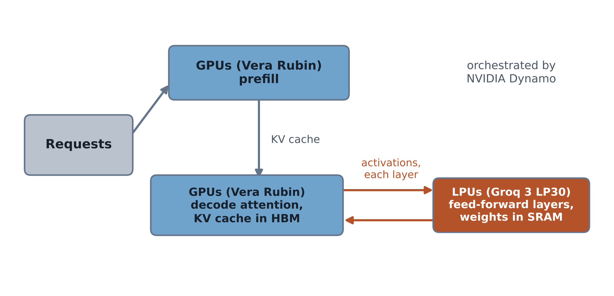

# Chapter 11: Navigating the Accelerator and Compiler Landscape

**Status: case study run on 2026-11-15 to 2026-11-23.** The measured results are in `results/`.

Companion code for Chapter 11. The case study runs the RAG pipeline's two generators, Gemma-2B-IT and
Llama-3.1-8B-Instruct, on NVIDIA A100 and H100 GPUs and on Google Cloud TPU v5e and v6e. For each configuration it
measures prefill time, time per output token at batch size 1 and numerical agreement with an FP32 CPU reference,
with PyTorch eager, `torch.compile`, vLLM 0.33.0 (BF16 and FP8 weights), TorchTPU and JAX. Separate experiments
measure batch invariance (determinism) in vLLM, ONNX Runtime against PyTorch, and how DTensor and JAX place the
collectives of a sharded matrix multiplication.

## Scripts

| Script | What it does |
|---|---|
| `common.py` | Shared settings: prompts, prompt length, number of new tokens, environment record |
| `jax_basics.py` | Code 11.1: a two-layer MLP in JAX with `grad`, `vmap` and `jit` (CPU, GPU or TPU) |
| `sharding_compare.py` | Code 11.2: the same row-sharded weight in PyTorch DTensor (`torchrun`, 2 GPUs) and in JAX |
| `colab/gpu_reference_v3.py` | GPU rows (eager, `torch.compile`, vLLM BF16 and FP8), median of repeats, top-1 agreement |
| `colab/determinism_colab.py` | Batch-invariance experiment: default and `VLLM_BATCH_INVARIANT=1` at 1, 16 and 64 concurrent requests |
| `colab/*.ipynb` | Colab notebooks for the GPU rows, the TPU rows and a GPU check |
| `h100/modal_h100_all.py` | All H100 rows and the determinism experiment on Modal in one command (`gpu="H100!"` pins the H100) |
| `h100/modal_ch11_fixups.py` | ONNX Runtime with and without IO binding, and the DTensor check on 2 H100s |
| `h100/modal_jax_shard_check.py` | The JAX half of Code 11.2 on 8 simulated CPU devices |
| `h100/modal_reference.py` | Earlier single-GPU reference script (kept for the commands in its docstring) |
| `tpu/torchtpu_gemma.py` | Code 11.3: TPU rows with TorchTPU (`torch.compile(backend="tpu")`) |
| `tpu/jax_gemma.py`, `tpu/run_jax.sh` | JAX rows on a TPU with KerasHub |
| `onnx/export_and_run.py` | Code 11.4: `torch.export` to ONNX and ONNX Runtime with the CUDA execution provider |
| `parity/cpu_reference.py` | FP32 CPU reference: greedy tokens and teacher-forced logits |
| `parity/compare_logits.py` | Code 11.5: KL divergence and top-1 agreement of a platform's logits with the reference |
| `determinism/run_determinism.py` | Stand-alone version of the batch-invariance experiment |
| `amd/bench_vllm.py`, `amd/mi300x_vllm.sh` | Optional MI300X rows with vLLM on ROCm (not part of the measured case study) |

## Results

| File | Platform and content |
|---|---|
| `results/colab_a100_r3_2026-11-15.json` | A100 80GB (Colab): both models, eager, `torch.compile`, vLLM; median of 3 |
| `results/colab_a100_determinism_2026-11-15.json` | A100: batch invariance, default and invariant mode |
| `results/modal_h100_2026-11-15*.json` | H100 80GB SXM (Modal): both models, all stacks, FP8, determinism |
| `results/modal_fixups_2026-11-16_0109.json` | H100: ONNX Runtime timings with outputs on the host and on the GPU; DTensor collectives |
| `results/cluster_h100_2026-11-23/` | H100 80GB SXM, GPU cluster node (2 x Intel Xeon Platinum 8468, 16 cores): both models, eager, `torch.compile`, vLLM BF16 and FP8, median of 3, with logs. Source of the H100 rows in Tables 11.8 to 11.10; the two Modal sessions show how much the eager and compiled rows depend on the host |
| `results/colab_tpu_v6e1_*.json`, `results/colab_tpu_v5e1_*.json` | TPU v6e and v5e (Colab): TorchTPU rows and repeats |
| `results/colab_tpu_v5e1_jax_2026-11-16.json` | TPU v5e: JAX rows and the precision comparison |
| `results/cluster_jax_shard_2026-11-19.json` | JAX sharding check on 8 CPU devices: output sharding and the collectives in the compiled program |

Each result file records the GPU or TPU, the driver and the package versions.

## Stack

vLLM 0.33.0, PyTorch 2.14, transformers 5.x, ONNX Runtime 1.32 (CUDA execution provider); JAX and TorchTPU on Colab
TPU runtimes. Gated models (Gemma, Llama) need a Hugging Face token: on Modal a secret named `huggingface`, on Colab
a Colab secret.

## Online resources

The print chapter refers to the material below. Reference numbers are those of the chapter.

### Selected accelerators (November 2026)

Vendor-stated dense peak rates per chip, memory and scale-up links. A dash means the format is not supported or not stated. TPU ICI figures are bidirectional. Cerebras quotes its peak with sparsity; the WSE-3 value is an estimated dense rate. Sources: references [15], [16] and [19] to [25] of the chapter.

| Accelerator | BF16 TFLOP/s | FP8 TFLOP/s | FP4 TFLOP/s | Memory | Bandwidth | Scale-up link |
|---|---|---|---|---|---|---|
| NVIDIA A100 SXM | 312 | – | – | 80 GB HBM2e | 2.04 TB/s | NVLink 600 GB/s |
| NVIDIA H100 SXM | 989 | 1,979 | – | 80 GB HBM3 | 3.35 TB/s | NVLink 900 GB/s |
| NVIDIA B200 (HGX) | 2,250 | 4,500 | 9,000 | about 180 GB HBM3e | 8 TB/s | NVLink 1.8 TB/s |
| AMD MI355X | 2,517 | 5,033 | 10,066 (MXFP4) | 288 GB HBM3E | 8 TB/s | Infinity Fabric |
| Google TPU v5e | 197 | – (INT8 393) | – | 16 GB HBM | 0.82 TB/s | ICI 400 GB/s |
| Google TPU v6e | 918 | – (INT8 1,836) | – | 32 GB HBM | 1.64 TB/s | ICI 800 GB/s |
| Google TPU7x (Ironwood) | 2,307 | 4,614 | – | 192 GiB HBM | 7.4 TB/s | ICI 1.2 TB/s |
| AWS Trainium3 | 671 | 2,517 (MXFP8) | 2,517 (MXFP4) | 144 GiB HBM | 4.9 TB/s | NeuronLink-v4 |
| Cerebras WSE-3 | about 12,500 (FP16, estimated dense) | – | – | 44 GB on-wafer SRAM | about 21 PB/s | System fabric |
| Groq 3 LP30 | – | 1,200 | – | about 500 MB SRAM | about 150 TB/s | 256 chips per LPX rack |

### Execution models of current accelerators

| Property | GPU (SIMT) | Systolic, compiler-scheduled | Spatial dataflow |
|---|---|---|---|
| Examples | NVIDIA, AMD Instinct | TPU, Trainium, Gaudi | Groq LPU (language processing unit), Cerebras WSE, SambaNova RDU |
| Who schedules | Hardware at run time | Compiler, with hardware queues | Compiler, fully static |
| Where weights live during decode | HBM | HBM | On-chip SRAM (SambaNova: SRAM, HBM and DDR) |
| Shapes | Dynamic | Static or bucketed | Static |
| Run-to-run timing | Variable | Mostly predictable | Predictable |
| Strength | Generality, software ecosystem | Efficiency on large matrix work | Latency at small batch |
| Main limit | Overhead per instruction | Compile time, shape changes | Capacity per chip, compile time |

### Disaggregation by layer type (NVIDIA LPX)

Disaggregation by layer type in NVIDIA's LPX configuration, as described by NVIDIA. Prefill and decode attention run on GPUs, where the KV cache is held in HBM; the feed-forward layers of decode run on SRAM-based LPUs; activations move between them at each layer. Source: reference [25].

### Sources of nondeterminism and their controls

| Source | Varies between | Control | Cost |
|---|---|---|---|
| Atomic accumulation | Identical runs | torch.use_deterministic_algorithms(True), CUBLAS_WORKSPACE_CONFIG | Slower kernels, errors where no deterministic kernel exists |
| Batch-dependent kernels | Runs with different load | Batch-invariant kernels (vLLM VLLM_BATCH_INVARIANT=1) | Lower throughput; some fast paths disabled |
| Collective algorithm | Message sizes, library versions | Fixed algorithm and versions; batch-invariant mode | Possibly slower collectives |
| Precision defaults | Platforms and frameworks | Explicit precision (TF32 off, precision=HIGHEST in JAX) | Up to several times slower FP32 matrix multiplications |
| FP8 variant | Vendors | Convert checkpoints and rescale | One conversion step |

### Exchange formats, compilers and runtimes (November 2026)

| Tool | Input | Targets | Typical use |
|---|---|---|---|
| ONNX Runtime | ONNX graphs | CPUs, NVIDIA, AMD, Intel, Apple, Qualcomm via execution providers | Portable inference of fixed graphs |
| XLA (OpenXLA) | StableHLO | TPUs, GPUs, CPUs, PJRT plugins | JAX and TorchTPU compilation |
| IREE | StableHLO, other MLIR dialects | CPUs, Vulkan, CUDA, ROCm, accelerators | Embedded and mobile deployment |
| TensorRT-LLM | Hugging Face checkpoints | NVIDIA GPUs | High-throughput NVIDIA serving |
| AOTInductor | torch.export programs | CPUs, GPUs | Python-free PyTorch deployment |
| ExecuTorch | torch.export programs | Phones, microcontrollers, NPUs | On-device inference |
| Apache TVM | Several frameworks | CPUs, GPUs, accelerators | Research, custom hardware |

### Debugging and profiling tools and switches by platform

| Platform | Profiler | Compiler diagnostics | Useful switches |
|---|---|---|---|
| NVIDIA GPU | Nsight Systems, Nsight Compute, PyTorch profiler | TORCH_COMPILE_DEBUG=1, TORCH_LOGS | CUDA_LAUNCH_BLOCKING=1, NVIDIA_TF32_OVERRIDE=0 |
| AMD GPU (ROCm) | rocprofv3 (ROCprofiler-SDK), PyTorch profiler | TORCH_COMPILE_DEBUG=1 | HIP_LAUNCH_BLOCKING=1 |
| Google TPU (JAX, TorchTPU) | XProf in TensorBoard | XLA_FLAGS=--xla_dump_to=DIR | TORCH_TPU_LAUNCH_BLOCKING=1, jax_default_matmul_precision |
| AWS Trainium | Neuron profiler (Neuron Explorer) | Neuron compiler logs | Neuron runtime log level |
| ONNX Runtime | Session profiling (JSON trace) | Graph optimization level settings | log_severity_level=0 for provider assignment |
| vLLM (any backend) | Engine metrics, PyTorch profiler | Attention backend selection logs | VLLM_LOGGING_LEVEL=DEBUG |
